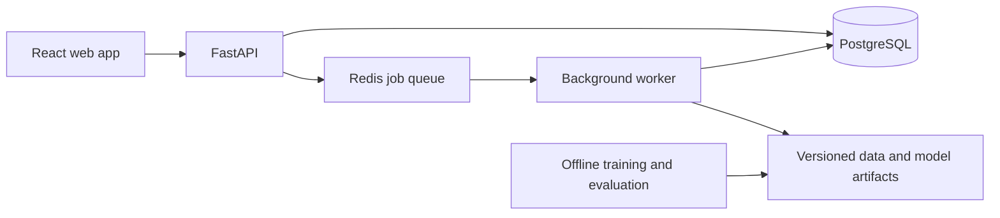

# FreshOps: stockout-aware forecasting and perishable inventory planning

## Project pitch

Build a web application that helps a small grocery shop decide what to order tomorrow, using historical sales, stock availability, inventory expiry, supplier lead times, and a purchasing budget. The owner can inspect a recommendation, understand its assumptions, override it, and compare the outcome with a simple ordering rule.

The first customer is one small grocery shop selling a limited range of perishables. A bakery is a possible later adaptation; do not design for groceries, restaurants, and campus kitchens simultaneously.

Example demo, with explicitly fictional quantities: a shop sold 20 milk units before selling out at noon. A naive model treats 20 as a full day's demand. FreshOps flags that sales were constrained by availability, estimates an uncertain demand range, and proposes an order while accounting for existing batches and tomorrow's budget. It records what the owner approved and why.

The distinguishing work is connecting imperfect data to a reliable decision. Forecasting alone, or a dashboard alone, is insufficient.

## Time and scope

- 120 work sessions at about 90 minutes each: approximately 180 hours.
- At five sessions per week, this is 24 weeks, approximately six months. Days below are work sessions, not calendar dates.
- Suggested session: 10 minutes review, 60 minutes one deliverable, 20 minutes verification and notes.
- This is an estimate for someone with basic Python, SQL, Git, and JavaScript. Add learning sessions when needed; do not sacrifice correctness to keep the dates.
- Each tenth session is a checkpoint and recovery session. If the milestone gate fails, carry unfinished work forward before adding scope.
- Aim for a usable baseline product by Day 60. The later milestones add stronger evaluation, reliability, deployment, and evidence.
- No GPU, paid LLM, or Kubernetes dependency in the core project. Cloud deployment costs depend on the provider and chosen resources; choose a spending cap before deployment.

## User workflow and minimum product

1. Owner signs in and selects their shop.
2. Owner uploads sales and availability CSVs, then records on-hand batches, expiry dates, supplier lead times, and costs.
3. Import validates rows, reports errors, and safely handles a repeated upload.
4. Background processing creates a next-day demand forecast and order proposal.
5. Owner sees recommended quantities, uncertainty, near-expiry stock, and reasons.
6. Owner adjusts or approves a draft purchase order; the application does not contact suppliers.
7. Owner records new sales and waste; a comparison page shows measured or simulated outcomes with their provenance.

Core screens: overview, import and data quality, inventory batches, order recommendations and approval, evaluation report. Keep the first version to 20–50 products and one supplier per product. Forecast one day ahead; show several days of history.

## Stack and the engineering reason for each choice

| Area | Choice | What you demonstrate |
|---|---|---|
| Frontend | React, TypeScript, Vite, Tailwind, a component library | Typed forms, useful tables, uncertainty charts, loading/error/empty states |
| Backend | Python FastAPI, Pydantic, SQLAlchemy, Alembic | Validated APIs, domain logic, migrations, transaction boundaries |
| Database | PostgreSQL | Relational modeling, tenant isolation, indexing, concurrency control |
| Offline data processing | Parquet and DuckDB | Reproducible analysis without loading everything into the application database |
| ML | pandas, scikit-learn, LightGBM | Baselines, feature engineering, quantile forecasting, temporal evaluation |
| Experiments | MLflow with a local artifact directory initially | Dataset/model versions, reproducible runs, controlled promotion |
| Async execution | Celery with Redis | Background jobs, retries, failure visibility, idempotent processing |
| Optimization | Simple order-up-to policy first; OR-Tools for constrained allocation | Converting uncertainty into decisions with budget and capacity limits |
| Verification | pytest, Playwright, k6 | Correctness, critical user journeys, reproducible performance evidence |
| Delivery | Docker Compose and GitHub Actions | Reproducible environments, automated checks, deployment |
| Operations | Structured logs, health checks, basic metrics | Diagnosis, queue visibility, backup and recovery |

Use a modular monolith and a separate worker process. The API and worker share domain code. Add a dedicated inference service only if measured workload requires independent scaling.

The database is the source of truth for import and job status. Queue delivery may repeat: uniqueness constraints and transactions prevent repeated delivery from repeating a business action. Local file storage is sufficient initially; an object-storage interface allows later migration.

Suggested entities: organizations, memberships, stores, products, suppliers, inventory_batches, inventory_events, import_runs, sales_observations, forecast_runs, forecasts, recommendation_runs, order_proposals, order_lines, audit_events. Include organization/store scope in relevant keys and authorization checks.

## Data: real forecasting data, explicit operational assumptions

Use the official [FreshRetailNet-50K dataset](https://huggingface.co/datasets/Dingdong-Inc/FreshRetailNet-50K), with attribution under its listed CC BY 4.0 license. It provides sales and stockout information suitable for studying demand hidden by stockouts. Read the [official baseline repository](https://github.com/Dingdong-Inc/frn-50k-baseline) as a reference; document any reused code and its license.

Important limitations:

- Sales quantities are normalized. Do not describe public-data quantities as literal milk cartons or report real rupee savings from them.
- The listed fields do not provide the complete operational ledger needed for this application. Expiry dates, purchase costs, supplier lead times, capacities, and budgets must come from a separately labeled demo fixture or a consenting pilot shop.
- Keep benchmark records, synthetic operational scenarios, and pilot records distinct.
- The history is short for learning yearly seasonality. Do not make annual-seasonality claims.
- Chinese retail benchmark results are not evidence of performance in an Indian grocery shop. Validate transfer separately.
- Natural stockouts hide the true missed demand. Forecast/recovery metrics and inventory simulation results need separate interpretations.

Start with a deterministic small subset, such as 100–500 store-product series. Expand for an offline benchmark only after the pipeline is correct. Do not import millions of records just to populate a demo screen.

## ML and optimization approach

1. Establish last-observation, same-weekday, and rolling-average baselines.
2. Create strictly lagged sales features and shifted rolling aggregates. Include only information available at the prediction cutoff.
3. Train a global LightGBM model across product-store series. Compare a simple stockout-aware training/recovery method against naive training; document the selection bias introduced by dropping stockout periods.
4. Train P10, P50, and P90 quantile models, then assess interval coverage and handle crossed quantiles explicitly.
5. For recovery evaluation, artificially mask portions of fully observed periods and compare recovered demand with the known withheld values. Explain that this masking does not fully reproduce natural stockout behavior.
6. Use rolling-origin validation. Keep the official evaluation period untouched until choices are locked. Fit preprocessing and recovery steps inside each training fold.
7. Use future weather only if it represents a forecast available at decision time. Otherwise omit it. Historical realized weather for tomorrow would leak information. Future stock availability is also not a valid known input.
8. Convert forecasts into replenishment using current usable inventory, lead time, shelf life, and a declared understock-versus-waste cost tradeoff. Start with a one-day horizon.
9. Add integer pack sizes, a common purchase budget, and storage limits through OR-Tools. Show infeasible and timed-out cases and a conservative fallback.
10. Evaluate the policy in a reproducible simulator before showing recommendations to a real user.

Example objective: minimize expected shortage cost + waste cost + holding cost, subject to purchase budget, storage capacity, pack sizes, and delivery timing. Use declared demand scenarios; do not claim quantiles alone define the full demand distribution. Call a result optimal only when the solver status supports it.

Forecast uncertainty does not remove stockout-recovery bias. Show assumptions and data-quality warnings alongside recommendations.

## Daily build plan

### Milestone 1 — Validate the problem and inspect data: Days 1–10

| Day | One main deliverable |
|---|---|
| 1 | Write a one-page problem statement, intended user, and tomorrow-ordering workflow. |
| 2 | Ask one shop owner how they order, track waste, and record stockouts; prepare questions if access is pending. |
| 3 | Inspect the official dataset card, license, columns, and normalization notes. |
| 4 | Load a small deterministic dataset subset and save its selection criteria. |
| 5 | Graph a few series with stockout periods and missing observations. |
| 6 | Document what is observed, hidden, unavailable, and synthetic. |
| 7 | Sketch the five screens with realistic example records. |
| 8 | Define the import format and first-version acceptance criteria. |
| 9 | Create the repository, development commands, and a short decision log. |
| 10 | Checkpoint: review feasibility, cut optional features, and finish gaps. |

Gate: you can demonstrate the input data and explain which business decision the product supports. If no shop is available, proceed with a clearly labeled research/demo product; keep pilot access as an open dependency.

### Milestone 2 — Build the backend foundation: Days 11–20

| Day | One main deliverable |
|---|---|
| 11 | Start FastAPI and PostgreSQL through Docker Compose. |
| 12 | Model stores, products, sales observations, and inventory batches. |
| 13 | Add the first migration and repeatable seed data. |
| 14 | Add maintained authentication support and organization memberships. |
| 15 | Enforce server-side organization and store access checks. |
| 16 | Implement product list/create/update APIs with validation. |
| 17 | Implement inventory batch and adjustment APIs using transactions. |
| 18 | Add pagination, consistent errors, and generated API documentation. |
| 19 | Verify critical inventory rules and cross-organization access denial. |
| 20 | Checkpoint: start from an empty database and repeat the core API workflow. |

Gate: two organizations cannot access each other's records, and inventory adjustments remain consistent.

### Milestone 3 — Build a usable frontend: Days 21–30

| Day | One main deliverable |
|---|---|
| 21 | Create React/TypeScript layout, navigation, and consistent UI tokens. |
| 22 | Implement sign-in, sign-out, and expired-session handling. |
| 23 | Build the product table, search, and basic editing form. |
| 24 | Build inventory batches with expiry and usable-stock indicators. |
| 25 | Build a CSV upload form with a downloadable example. |
| 26 | Add synchronous import validation and actionable row errors. |
| 27 | Display sales history and the rolling-average forecast baseline. |
| 28 | Add loading, empty, failed-request, and small-screen states. |
| 29 | Verify keyboard access and one browser journey from sign-in to upload. |
| 30 | Checkpoint: record a short working-product demo and fix its biggest friction. |

Gate: a user can import data and inspect inventory without using a notebook or API console.

### Milestone 4 — Establish trustworthy ML baselines: Days 31–40

| Day | One main deliverable |
|---|---|
| 31 | Define the prediction cutoff, next-day target, and permitted inputs. |
| 32 | Create chronological train/validation windows and reserve the final holdout. |
| 33 | Implement naive and same-weekday forecasts. |
| 34 | Implement a rolling-average forecast and consistent scoring. |
| 35 | Create lagged features and shifted rolling statistics. |
| 36 | Train the first global LightGBM point-forecast model. |
| 37 | Compare errors and bias across products, stores, and stockout exposure. |
| 38 | Check leakage with feature timestamps and deliberately broken examples. |
| 39 | Save dataset selection, features, seeds, parameters, and results for reproduction. |
| 40 | Checkpoint: write a baseline report, including where ML loses. |

Gate: one command reproduces the baseline comparison on temporal validation. Improvement is a research result to measure, not a promised milestone.

### Milestone 5 — Handle stockouts and uncertainty: Days 41–50

| Day | One main deliverable |
|---|---|
| 41 | Analyze how recorded sales differ between available and stockout periods. |
| 42 | Implement a simple historical-only stockout recovery estimate. |
| 43 | Construct masked evaluation examples from fully observed periods. |
| 44 | Compare recovery with a simple reference method on masked values. |
| 45 | Retrain the forecasting pipeline with recovery confined to training windows. |
| 46 | Train P10, P50, and P90 quantile forecasts. |
| 47 | Measure pinball loss, interval coverage, and quantile crossing. |
| 48 | Define cold-start, insufficient-data, and failed-model fallbacks. |
| 49 | Show forecast ranges, model version, freshness, and warnings in the UI. |
| 50 | Checkpoint: write the model card and explicitly state recovery limitations. |

Gate: forecasts expose uncertainty and data limitations; you can explain the evaluation without assuming hidden demand is known.

### Milestone 6 — Turn predictions into order decisions: Days 51–60

| Day | One main deliverable |
|---|---|
| 51 | Define labeled demo costs, shelf lives, lead times, and pack sizes. |
| 52 | Implement a simple order-up-to replenishment policy. |
| 53 | Account for usable inventory and first-expiry-first-out consumption. |
| 54 | Build a small day-by-day inventory simulator with deterministic fixtures. |
| 55 | Compare the baseline and forecast policies under identical scenarios. |
| 56 | Formulate budget, storage, and pack-size constraints for OR-Tools. |
| 57 | Implement constrained ordering and expose infeasible/timeout outcomes. |
| 58 | Build a recommendation screen with a transparent quantity breakdown. |
| 59 | Add human overrides and approval of a saved draft purchase order. |
| 60 | Checkpoint: demo upload → forecast → recommendation → approval. |

Gate: the baseline product is usable end to end. Order approval uses the inventory version it was based on or asks for recalculation when stale.

### Milestone 7 — Make processing reliable: Days 61–70

| Day | One main deliverable |
|---|---|
| 61 | Move imports and forecast computation into Celery workers. |
| 62 | Add database-backed job status and progress endpoints. |
| 63 | Add import checksums/keys and uniqueness constraints for deduplication. |
| 64 | Add bounded retries and distinguish permanent from temporary failures. |
| 65 | Make worker writes safe under duplicate delivery. |
| 66 | Recover queued work after a worker restart using persisted job records. |
| 67 | Add timeouts and owner/admin visibility into failed jobs. |
| 68 | Poll job progress in the UI and support safe retry. |
| 69 | Verify duplicate upload, worker crash, and repeated approval scenarios. |
| 70 | Checkpoint: demonstrate a forced failure and successful recovery. |

Gate: restarting processing cannot silently duplicate sales, inventory events, or approved orders. Do not claim exactly-once queue delivery.

### Milestone 8 — Add a controlled model lifecycle: Days 71–80

| Day | One main deliverable |
|---|---|
| 71 | Track experiment parameters, metrics, and artifacts in MLflow. |
| 72 | Version the feature schema, dataset manifest, and model together. |
| 73 | Package one reproducible training and evaluation command. |
| 74 | Add validation gates for schema, missingness, and feature ranges. |
| 75 | Compare a candidate model against the current baseline before promotion. |
| 76 | Implement explicit model selection and rollback to a known version. |
| 77 | Track data freshness and simple feature-distribution changes. |
| 78 | Join later observed outcomes to forecasts for delayed-error monitoring. |
| 79 | Run the locked final holdout once and record the result without tuning on it. |
| 80 | Checkpoint: reproduce an experiment and demonstrate a rollback. |

Gate: each recommendation identifies its data cutoff, model version, and policy configuration. Drift raises a review signal; it does not automatically justify retraining or promotion.

### Milestone 9 — Verify business value honestly: Days 81–90

| Day | One main deliverable |
|---|---|
| 81 | Declare the simulator's demand, cost, expiry, and lead-time assumptions. |
| 82 | Add shortage, waste, holding-cost, and service-level metrics. |
| 83 | Run rolling historical scenarios and separate synthetic-demand scenarios. |
| 84 | Compare naive, forecast-only, and constrained policies on the same scenarios. |
| 85 | Stress low budgets, sparse history, demand spikes, and delayed delivery. |
| 86 | Measure sensitivity to assumed waste and shortage costs. |
| 87 | Add an evaluation view labeled as benchmark, simulation, or pilot evidence. |
| 88 | Ask an owner to review recommendations, or conduct a recorded usability session. |
| 89 | Fix the highest-impact issue and document remaining user feedback. |
| 90 | Checkpoint: publish a result table, assumptions, and failure cases. |

Gate: you can defend every claimed improvement. A replay against observed stockout-constrained sales is not proof of real lost-sales or waste reduction.

### Milestone 10 — Exercise system design through failures: Days 91–100

| Day | One main deliverable |
|---|---|
| 91 | Define a reproducible load profile, dataset size, and latency targets. |
| 92 | Add request/job identifiers and structured logs. |
| 93 | Expose API latency, error counts, job duration, and queue backlog. |
| 94 | Run a small load test and inspect slow database queries. |
| 95 | Add justified indexes and rerun the same workload. |
| 96 | Verify transaction handling for concurrent inventory adjustments. |
| 97 | Handle concurrent order approval using a version check or row locking. |
| 98 | Add upload limits, rate limits, and safe parsing of untrusted CSVs. |
| 99 | Write the scaling design using measured bottlenecks and explicit assumptions. |
| 100 | Checkpoint: record benchmark hardware, workload, p95 latency, and limitations. |

Gate: performance claims are repeatable and scoped to measured hardware; tenant isolation and inventory consistency survive adverse cases.

### Milestone 11 — Deploy and operate the product: Days 101–110

| Day | One main deliverable |
|---|---|
| 101 | Clean up container configuration, environment variables, and secret handling. |
| 102 | Add CI checks for backend correctness and frontend build. |
| 103 | Add CI coverage for the critical browser journey. |
| 104 | Choose one hosting environment, set a spending cap, and document deployment. |
| 105 | Deploy a private or limited-access environment with HTTPS and migrations. |
| 106 | Add a resettable demo account using synthetic operational records. |
| 107 | Back up the database and perform a restore into a separate database. |
| 108 | Verify health checks and recovery after application/worker restart. |
| 109 | Run acceptance checks against the deployed application. |
| 110 | Checkpoint: publish the stable demo and a short operations runbook. |

Gate: another person can use the deployed workflow, and you have practiced recovery. Keep personal/shop data out of public demo seeds.

### Milestone 12 — Make the work assessable: Days 111–120

| Day | One main deliverable |
|---|---|
| 111 | Write a README with problem, demo, setup, and project scope. |
| 112 | Add architecture and data-flow diagrams reflecting the implemented system. |
| 113 | Write a short case study explaining stockout-censored demand. |
| 114 | Write a design note on idempotency, concurrency, and failure recovery. |
| 115 | Publish the model card, benchmark table, and simulator assumptions. |
| 116 | Record a three-minute demo with one happy path and one recovery case. |
| 117 | Ask someone unfamiliar with the repository to follow setup instructions. |
| 118 | Fix their biggest setup or UX problem and create a tagged release. |
| 119 | Draft separate SDE and ML resume bullets using measured results only. |
| 120 | Rehearse a ten-minute explanation and choose the next evidence-backed feature. |

Gate: the demo, repository, evaluation, and explanation tell the same defensible story.

## Evaluation and proof to collect

| Dimension | Evidence |
|---|---|
| Forecasting | MAE/WAPE with aggregate-denominator handling, bias, quantile pinball loss, interval coverage; breakdown by product and data quality |
| Demand recovery | Error on intentionally masked observed periods, plus an explicit natural-stockout limitation |
| Decisions | Simulated total cost, waste quantity, shortage quantity, and fill rate under declared scenarios |
| Reliability | Duplicate imports, duplicate job delivery, crash recovery, concurrent approval, and cross-tenant access checks |
| Performance | Reproducible load definition, hardware, p50/p95 latency, errors, queue backlog, and processing duration |
| Product | User interview notes, observed usability problems, overrides, and recorded feedback |

Targets are hypotheses. For example, aim to outperform the strongest simple forecast baseline or reduce simulated decision cost without a large fill-rate drop. If that fails, document the failure and use the stronger baseline. A correct negative result is better than a misleading improvement claim.

## Scale-up design to explain in interviews

At the initial scale, use one API, a worker, PostgreSQL, and Redis. Batch next-day forecasts and persist them so most page reads do not invoke a model. At larger scale, measure queue backlog and scale workers, move artifacts to object storage, and partition large observation tables when query patterns justify it. Isolate heavy training from operational workloads. Evaluate whether tenant-specific or shared models work better with sufficient data.

Discuss how the design would change for 1,000 stores × 500 products = 500,000 store-product forecasts per daily run. This is a design scenario, not a supported-scale claim. Estimate record volume, batch duration, database write throughput, tenant fairness, and recovery behavior before choosing extra infrastructure.

## Optional work after the core release

Choose one extension based on measured value; each needs its own time allocation beyond Day 120.

- Deep learning: compare a compact temporal model with LightGBM on the same temporal splits and compute budget. Retain it only if it offers a useful accuracy/latency tradeoff.
- Grounded language assistant: let an owner ask why an order changed. Use authorized read-only tools returning recommendation IDs and metrics. Derive numbers in application code, cite records, evaluate numerical faithfulness, and require the existing human approval flow for changes. This does not require training a language model.
- Offline capture: store pending inventory events locally and reconcile them with server-side deduplication and conflict handling.
- Multi-store transfers: optimize stock movement before placing new supplier orders.
- Real pilot: collect consented local data and evaluate whether the model transfers. This is usually more valuable than adding another infrastructure tool.

## Resume templates: replace brackets with verified measurements

SDE: Built and deployed a multi-tenant inventory-planning application with transactional stock updates, idempotent background jobs, and tested crash recovery; measured [p95 latency] at [declared workload and hardware].

ML: Trained and evaluated stockout-aware quantile demand forecasts against [baseline] using rolling temporal validation; achieved [measured forecast result] and [simulated cost result] under documented inventory assumptions.

Product: Piloted the recommendation workflow with [actual number] users/stores and revised [feature] from observed feedback. Omit this claim if no pilot occurred.

Be ready to explain why sales are not demand, how you prevent leakage, why a simpler model can win, how costs change the ordering policy, why retries do not duplicate effects, and how simulated improvements differ from real-world impact.

## Sources

- [UNEP: Food Waste Index 2024 findings](https://www.unep.org/en/news-and-stories/press-release/world-squanders-over-1-billion-meals-day-un-report): context for retail and food-service waste, not evidence of this application's impact.
- [Official FreshRetailNet-50K dataset card](https://huggingface.co/datasets/Dingdong-Inc/FreshRetailNet-50K/blob/main/README.md): available fields, normalization, stockout annotations, and license.
- [Official dataset baseline repository](https://github.com/Dingdong-Inc/frn-50k-baseline): demand recovery and forecasting references.
- [Google OR-Tools introduction](https://developers.google.com/optimization/introduction): supported optimization approaches.
